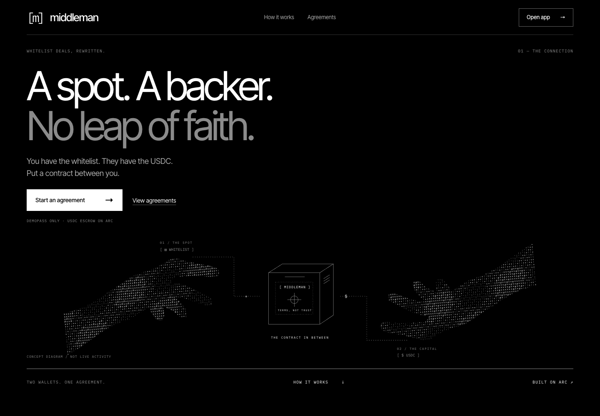

# Middleman

**One wallet has the spot. Another has the funds. Middleman makes the deal.**

USDC escrow for NFT whitelist deals on Arc. A whitelist holder brings access; a funder brings capital. Both agree onchain terms instead of sending money to a stranger. DemoPass mint payment and NFT delivery into escrow happen atomically; a later fixed-price purchase distributes the proceeds.

**Deployed on Arc mainnet; end-to-end deal validation on testnet only. Unaudited.** Mainnet source verification is pending an explorer API access issue. No funded mainnet deal has been run.



## Start here

- **App target:** https://trymiddlemanonarc.vercel.app — hosting rollout in progress.
- **[Mainnet deployment receipt](https://explorer.arc.io/tx/0x57a9677d2613a7e1fcf6f28381ff08256245b46c03f2f8d63b518269e3f7d6d6)** — actual contract creation, not a placeholder.
- **[Testnet sale receipt](https://explorer.testnet.arc.io/tx/0x702548496f0668b165de00ef396c79659de358af0aa07cbd4affda168a2591bd)** — real-wallet browser flow, not mainnet settlement.
- **Founder walkthrough:** in production; will distinguish testnet interaction from mainnet deployment.

## The deal in 30 seconds

1. **Propose:** choose the holder, funder, collateral, deadlines, sale price and split.
2. **Accept:** both parties commit to the same immutable terms.
3. **Fund:** the funder deposits USDC; the holder posts collateral.
4. **Mint atomically:** escrow pays DemoPass and receives the NFT in one transaction. Failed payment or delivery reverts the whole mint. The holder cannot withdraw principal.
5. **Purchase:** a buyer pays the fixed USDC price and receives the NFT.
6. **Settle:** the contract returns principal and distributes proceeds/collateral under the agreed rules.

**Why Arc?** USDC is both the escrow asset and native gas currency: no separate volatile gas token is needed. Deals, NFT custody and settlement receipts are inspectable on Arc. Native gas accounting uses 18 decimals; the ERC-20 USDC interface uses 6 decimals, backed by the same balance.

## Mainnet proof

| Item | Arc mainnet · chain `5042` |
| --- | --- |
| Middleman | [`0x18f7407d76429f66a5a977eac0a71cbc9fe05036`](https://explorer.arc.io/address/0x18f7407d76429f66a5a977eac0a71cbc9fe05036) |
| DemoPass | [`0xEdD3cBF58B797B2d4bc06e62C1cFbD42e4BaD229`](https://explorer.arc.io/address/0xEdD3cBF58B797B2d4bc06e62C1cFbD42e4BaD229) |
| Deployment block | `26090372` |
| Immutable DemoPass mint price | **0.01 USDC** |
| Creation fee, both contracts | **0.074113725 USDC** |
| Checks completed | Successful receipt; code and USDC/collection/escrow/owner/treasury/price bindings read back from RPC |
| Pending | Explorer source verification; complete mainnet deal validation |

[Full deployment evidence](docs/DEPLOYMENTS.md) · [Raw mainnet receipt/configuration](docs/MAINNET_DEPLOYMENT.json)

## What has been tested

- **20 contract tests**, including 1,000 payout fuzz cases, passed with standard and Arc Foundry. Covers payment/payout/refund rollback, custody, timeout, cancellation and reentrancy.
- **Arc testnet:** source-verified contracts, one scripted settlement and a separate complete real-Rabby-wallet UI sale. The latter paid 2.20 test USDC to the funder and 1.05 to the holder, delivered the NFT to the buyer and left zero escrow reserves.
- **8 web tests** cover amounts and fail-closed deployment configuration. ABI checks, lint, typecheck and production build are release checks.
- Rabby could not simulate the custom-network calls; signer, destination and calldata were checked before signing. Other wallets and public-chain refund/failure paths remain unverified.

## Scope and risks

V1 supports **DemoPass only**, not arbitrary whitelist collections. There is no escrow administrator or platform fee; DemoPass eligibility is managed by its owner.

Atomic minting protects against **non-delivery, not investment losses**. After minting, principal has bought an NFT: no guaranteed buyer, repricing or deadline refund exists. The NFT and collateral can remain locked indefinitely. Before minting, timeout/cancellation outcomes depend on funding state; see [financial and security rules](docs/SECURITY.md).

**No independent audit.** The last dependency review found 27 unresolved advisories (5 high, 22 moderate); see [dependency disclosure](docs/DEPENDENCIES.md). USDC restrictions can prevent transfers. Mainnet deployment is not a claim of production readiness or grant acceptance.

## Run locally

```sh
cd web
npm ci
cp .env.example .env.local # public TESTNET settings only
npm run dev
```

Routes: `/` · `/deals` · `/deals/new` · `/deals/[id]` · `/mint`. Missing deployment settings disable transactions. Never place private keys in frontend or Vercel variables.

```sh
# contracts/ — install the pinned toolchain/dependencies from the runbook first
forge test
arc-forge test --network arc --match-contract MiddlemanTest -vv

# web/ — after compiling contracts
npm run test
npm run check:abi
npm run lint
npm run typecheck
npm run build
```

Built with Solidity, OpenZeppelin, Foundry, Next.js, TypeScript, shadcn/ui, wagmi, viem and RainbowKit.

[Deployment runbook](docs/DEPLOYMENT.md) · [Current state and setup](docs/CURRENT_STATE.md) · [Design rationale](docs/DESIGN.md)
